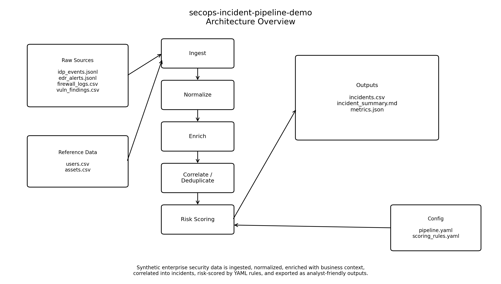
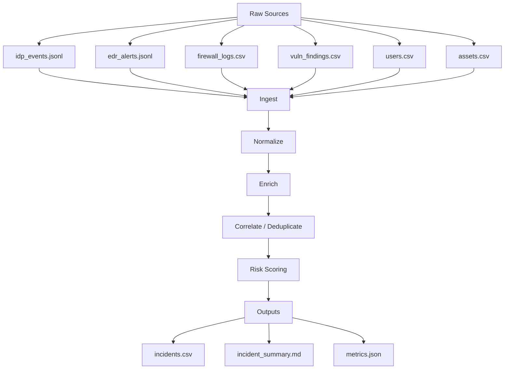
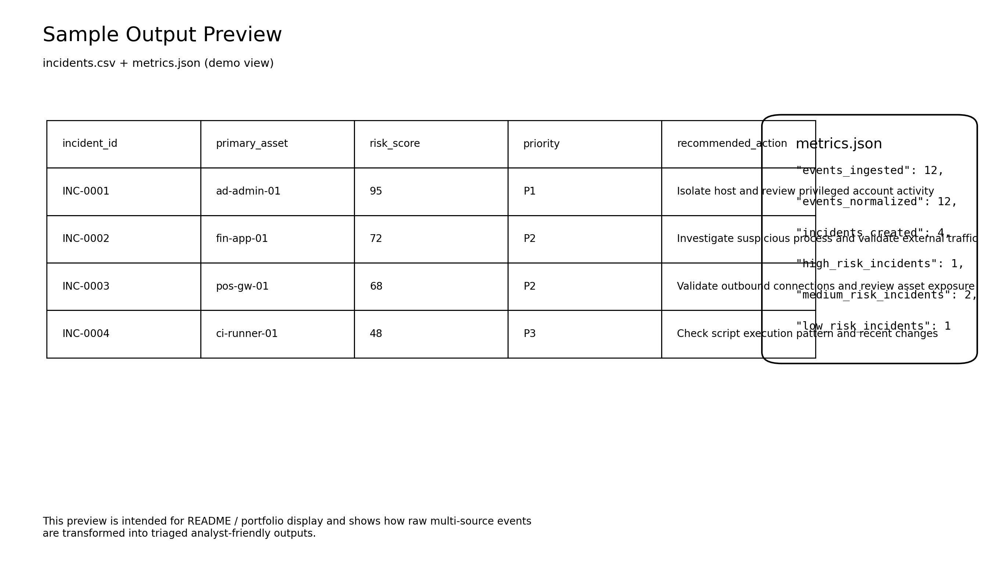

# secops-incident-pipeline-demo


A config-driven Python pipeline that ingests synthetic security events from multiple sources, normalizes and enriches the data, correlates related alerts, scores incident risk, and exports a triaged incident queue with summary outputs.

---

## Highlights

- Multi-source synthetic event ingestion
- Common-schema normalization
- User and asset context enrichment
- Incident correlation and deduplication
- Rule-based risk scoring via YAML config
- CSV, Markdown, and JSON outputs
- CLI-driven local execution
- Portfolio-ready demo for Python pipelines and system integration

---

## Why this project exists

Security-relevant events often come from separate systems such as:

- identity provider logs
- endpoint detection alerts
- firewall traffic logs
- vulnerability findings
- user and asset inventories

These sources usually differ in format, severity scales, and context quality.

This project demonstrates how a Python pipeline can turn fragmented raw events into a consistent, prioritized incident queue.

---

## Demo scenario

This repository simulates a realistic SecOps / SOC workflow in a fictional mid-sized enterprise:

**AcmeRetail Taiwan**
- 350 employees
- Multiple office locations
- E-commerce platform
- Hybrid IT environment across internal systems and cloud services

The security team receives fragmented events from different systems, but the data is difficult to triage manually.  
This demo shows how Python can be used to unify, enrich, correlate, and prioritize those signals into actionable incidents.

---

## Architecture





---

## Pipeline stages

### 1. Ingest
Load raw synthetic data from JSONL and CSV sources.

### 2. Normalize
Map source-specific fields into a common event schema.

### 3. Enrich
Add contextual information from user, asset, and vulnerability reference data.

### 4. Correlate
Group related events into incidents and reduce duplication.

### 5. Score
Apply YAML-driven risk scoring rules to assign priority.

### 6. Export
Write triaged outputs for analyst review and reporting.

---

## Synthetic data sources

This project uses only synthetic demo data. No real company or personal data is included.

### Raw event sources
- `data/raw/idp_events.jsonl`
- `data/raw/edr_alerts.jsonl`
- `data/raw/firewall_logs.csv`
- `data/raw/vuln_findings.csv`

### Reference data
- `data/ref/users.csv`
- `data/ref/assets.csv`

These datasets simulate:
- privileged and non-privileged users
- critical and non-critical assets
- exploitable vulnerabilities
- suspicious login behavior
- endpoint detection activity
- network traffic anomalies

---

## Risk scoring

Risk scoring is rule-based and configured through YAML.

Example considerations:
- source severity
- privileged user
- critical asset
- known exploitable vulnerability
- suspicious geography
- possible command-and-control traffic
- repeated correlated activity

Example output fields:
- `risk_score`
- `priority`
- `recommended_action`

Configuration lives in:
- `config/scoring_rules.yaml`
- `config/pipeline.yaml`

---

## Project structure

```text
secops-incident-pipeline-demo/
├─ README.md
├─ requirements.txt
├─ pyproject.toml
├─ .env.example
├─ Makefile
├─ config/
│  ├─ pipeline.yaml
│  ├─ scoring_rules.yaml
│  └─ source_map.yaml
├─ data/
│  ├─ raw/
│  ├─ ref/
│  └─ output/
├─ src/
│  ├─ main.py
│  ├─ pipeline/
│  │  ├─ ingest.py
│  │  ├─ normalize.py
│  │  ├─ enrich.py
│  │  ├─ correlate.py
│  │  ├─ score.py
│  │  └─ export.py
│  ├─ models/
│  ├─ rules/
│  └─ utils/
├─ tests/
└─ docs/
   ├─ architecture.png
   └─ sample-output.png
```

---

## Quick start

### 1. Create a virtual environment

```bash
python -m venv .venv
source .venv/bin/activate
```

### 2. Install dependencies

```bash
pip install -r requirements.txt
```

### 3. Prepare environment variables

```bash
cp .env.example .env
```

### 4. Run the pipeline

```bash
python src/main.py --config config/pipeline.yaml
```

---

## Example outputs

After execution, the pipeline generates:

- `data/output/incidents.csv`
- `data/output/incident_summary.md`
- `data/output/metrics.json`

### Sample output preview



### Example incident fields

| incident_id | primary_asset | risk_score | priority | recommended_action |
|---|---|---:|---|---|
| INC-0001 | ad-admin-01 | 95 | P1 | Isolate host and review privileged account activity |
| INC-0002 | fin-app-01 | 72 | P2 | Investigate suspicious process and validate external traffic |

---

## Testing

Run tests with:

```bash
pytest
```

Suggested test coverage includes:
- normalization logic
- enrichment behavior
- scoring rules
- pipeline smoke test

---

## Configuration

This project is intentionally config-driven to make rule changes easy without large code modifications.

### Main config
- `config/pipeline.yaml`

### Scoring rules
- `config/scoring_rules.yaml`

### Example environment variables
See `.env.example` for:
- log level
- input/output directories
- correlation window
- feature toggles

---

## Why this is portfolio-ready

This repo is designed to showcase:

- Python pipeline design
- ETL-style processing
- system integration thinking
- synthetic enterprise data modeling
- maintainable backend-oriented structure
- security-aware triage workflows

It reflects the kind of practical engineering work involved in integrating messy data sources, structuring business logic, and producing actionable outputs.

---

## Future improvements

Possible next steps:

- Docker support
- GitHub Actions CI
- DuckDB-based analytical queries
- HTML report export
- Streamlit dashboard
- richer detection rules
- source adapters for mock APIs
- stronger data quality validation

---

## Notes

- All data in this repository is synthetic and created for demonstration purposes.
- This project is intended to showcase engineering approach and pipeline design, not to represent a production-ready SOC platform.

---

## License
This project is licensed under the [MIT License](./LICENSE).
